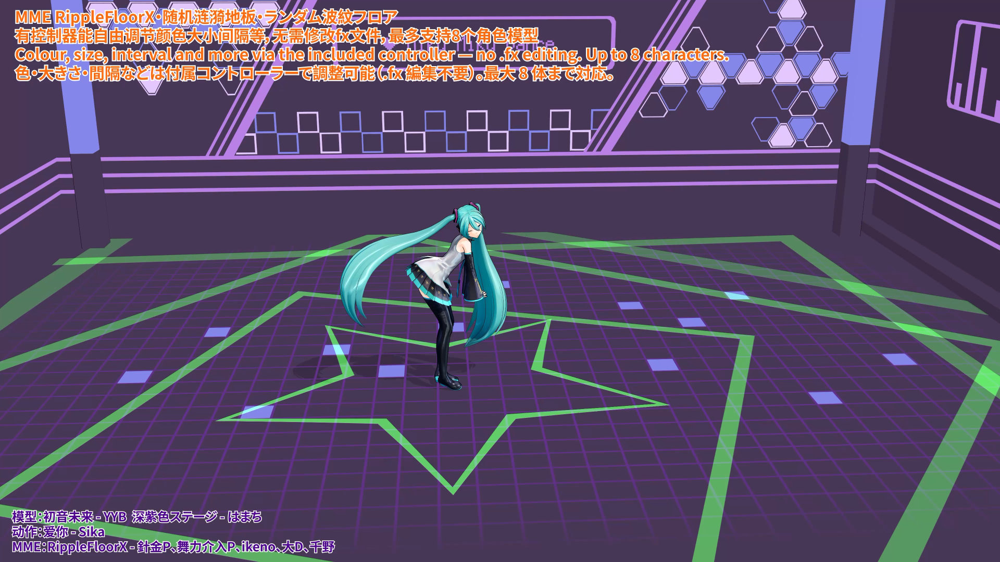

# MME RippleFloorX 随机涟漪地板

脚落地就长出一圈涟漪的 MME 地板特效。

## 它做什么

- 脚落地 → 在落点长出一圈涟漪，自己扩散约 5 秒后消失
- 连续走/跳 → 每个落点各一圈，叠成一串不同半径的环
- 站着不动（含播放动画时的 idle 摆动）→ 完全不出
- 图案有五种，轮流出现：放射线 / 三角形 / 正方形 / 圆 / 五角星

不写死模型名：换角色不用改任何文件。
备注：本MME由舞力介入P的「Innocencer」改造而来，解决了原版必须编辑fx文件手动添加模型名称的痛点。
参考了針金P的「WorkingFloorX」和ikeno的「WF_XxShadow」后进行了无需编辑文件，直接拖入模型就能使用的不绑定改进，并添加了五角星图案，和可以控制涟漪的控制器。

[youtube视频效果预览](https://www.youtube.com/watch?v=xRW_RGd-n_Y)
[B站视频效果预览](https://www.bilibili.com/video/BV12Dxv6LE63/)

## 文件

| 文件 | 说明 |
| --- | --- |
| `RippleFloorX.x` | 地板配件（20×20 平面，y=0）**← 载入这个** |
| `RippleFloorX.fx` | 地板本体 |
| `RF_FootRipple.fxsub` | 每个模型的「脚部报告器」（自动挂上，Shift-JIS） |
| `RippleFloorCtrl.pmx` | 参数控制器（可选） |

四个效果文件放同一个文件夹（MME 0.33+ 可用）。

> ★ `.fx` 与 `.fxsub` 必须同版，标记格式是两边共用的约定。

同内容的其它版本：`readme_cn.txt`（纯文本）、`readme_en.txt`、`readme_jp.txt`。
原理、全部可调参数、调试与构建方法在 [`docs/TECH.txt`](docs/TECH.txt) —— 普通使用不需要看。

## 使用

1. 先载入深色的地面模型（推荐），再拖角色模型进去。
2. 载入 `RippleFloorX.x`，在附件面板改数值：Y 设成地板高度 +0.1 左右；Si 可以改地板大小；Tr 可以整体调透明度。
3. 查看 背景 → 附件编辑，确保 `RippleFloorX.x` 的描画在地面模型后面（不懂就把数字改成 0）；再确认 MMEffect 的特效分配里 `RippleFloorX.x` 在地面模型下面。
4. 要调颜色 / 大小 / 间隔：再载入 `RippleFloorCtrl.pmx`（可以关掉它的显示）。
5. 操控角色的足 IK 抬起放下，能正常出现涟漪就成功了。
6. 改了 `.fx` 之后必须重开 MMD 或重新载入地板配件（MME 不会热重编译）。

支持最多 **8 个**角色模型。多人时把 `Freq-` 拉到 0.4~0.5（见下表），否则环会互相挤掉、看起来忽有忽无。

## 控制器表情（`RippleFloorCtrl.pmx`，可选）

全部表情 0 = 不改变：不载入控制器、或载入了但表情为 0，效果与默认完全一样。
表情名必须完全一致（ASCII、区分大小写）。

| 表情 | 作用 | 拉满（1.0） |
| --- | --- | --- |
| `Hue+` / `Hue-` | 色相顺时针 / 逆时针 | 转一整圈 |
| `Bright+` / `Bright-` | 亮度 | ×3 / ÷3 |
| `Freq+` / `Freq-` | 每模型出环间隔 | 0.13 秒（更密）/ 5.2 秒（更疏） |
| `Life+` / `Life-` | 涟漪寿命 | 15 秒（更长更大）/ 1.7 秒（更短更小） |
| `Step+` / `Step-` | 滑步阈值 | ×3 只认大步 / ÷3 轻微滑动也算一步 |
| `TriSz+` / `TriSz-` | 三角形尺寸 | 2.5× / 0.4× |
| `SqrSz+` / `SqrSz-` | 正方形尺寸 | 同上 |
| `CirSz+` / `CirSz-` | 圆形尺寸 | 同上 |
| `StarSz+` / `StarSz-` | 五角星尺寸 | 同上 |
| `LineSz+` / `LineSz-` | 放射线线宽 | 同上 |
| `Jitter` | 每条涟漪的尺寸抖动 | 每条 ±25%（0 = 不抖） |
| `Rot+` / `Rot-` | 图案旋转速度 | 10.0 / 1.6 rad/s（默认 4.0） |

**几个要点**

- 同一图案的 `+` 与 `-` 可以同时对拉，倍率 = `(1 + 1.5·P) / (1 + 1.5·M)`，两边都拉满正好抵消回 1.0 倍（方便回中位）。
- 想让五种图案「大小不一」：给几个 `Sz±` 不同的值；想让每一圈都不一样：再开 `Jitter`（它只改可见尺寸，不影响出环频率）。
- 多人（5~8 个）时 `Freq-` 至少 0.25（间隔 1.6 秒），0.4~0.5 更稳。
- `Life+` 拉满会更快塞满队列，最早的环被提前挤掉；想「又长又满」要同时把 `Freq-` 往疏里调。
- `Rot±` 只对三角 / 方 / 星可见（圆与放射线转了看不出来）。
- 表情支持注册关键帧：例如每隔 1000 帧注册一次 `Hue+` 的变化，就能得到颜色随时间变化的图案。
- 附件面板可以勾选「加算」：深色地面下勾上会显示辉光；不勾则是透明地板 + 实色图案（白底、亮底也能看清）。

## 排查

### 1. 完全没有特效

- MME 版本是否 ≥ 0.33
- 特效分配里 `RippleFloorX` 在不在；角色有没有挂上 `RF_FootRipple`
- 地板 Y 是否和角色站的平面一致（差一点点就不触发）

### 2. 有环但位置偏

环心是踝骨在地板上的投影，脚背长的模型会偏一点，属正常。

### 3. 环太大 / 太小 / 太快

先用 `Life±`、`Sz±` 表情调；要改根本数值看 `docs/TECH.txt` 的 `RIP_RADIUS` / `RIP_MAX`。

### 4. 多人时环忽有忽无

队列被挤爆了，把 `Freq-` 拉大（≥ 0.25）。

### 5. 改了没反应

- MME 不会热重编译 `.fx`：重开 MMD 或重新载入地板配件
- 还不行就把 `.fx` 顶部的 `DEBUG_HUD` 改成 1 看调试色带（含义见 `docs/TECH.txt`）

## 版权

- 离屏挂载：針金P「WorkingFloorX」
- 涟漪队列：舞力介入P「Innocencer」（千野改造）
- 高度投影（0.1 那版）：ikeno「WF_XxShadow」

按原作者说明，改造 / 二次配布自由。

使用本 MME 可以不写 Credits；如果乐意加上，请写：**針金P、舞力介入P、ikeno、大D、千野**

---

2026-10-31 · DeepSeek-V4.1-Flash-1017 & 千野
